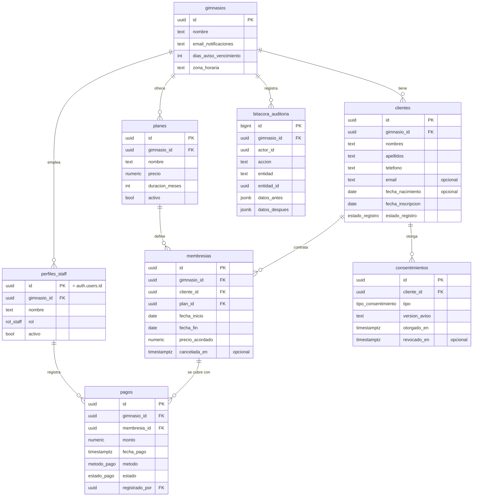

# Modelo de datos, fase 1

> Fuente de verdad del código: [`api/prisma/schema.prisma`](../api/prisma/schema.prisma). Este documento explica **por qué** el modelo es así.

## Diagrama entidad-relación



## Convenciones (y por qué)

| Convención | Por qué |
|---|---|
| PK `uuid` generada por la BD | No revela cuántos clientes hay (`/clientes/42` sí lo revela), no choca al unir datos de varios gimnasios y se puede generar en cualquier capa. La excepción es `bitacora_auditoria`: usa `bigint` autoincremental porque solo crece y el orden importa. |
| `gimnasio_id` en todas las tablas de negocio | **Multi-tenant** desde el día 1. Filtrar por tenant es una sola condición y no requiere `JOIN`. Es redundante en `membresias` y `pagos` a propósito: es *desnormalización controlada* por seguridad y rendimiento. |
| `created_at` y `updated_at` en todo | Depuración, auditoría básica y sincronización futura. |
| Tablas y columnas en `snake_case` y en español | PostgreSQL convierte a minúsculas los nombres sin comillas, así que `snake_case` evita comillas. Prisma mapea a `PascalCase`/`camelCase` en el código con `@@map` y `@map`. |
| Dinero en `numeric(10,2)` | `float` no puede representar 0.1 exactamente, y en contabilidad un centavo perdido es un bug. |
| Enums para estados | La BD rechaza valores inválidos (`'activo '`, `'Activo'`). |
| `ON DELETE RESTRICT` en FKs | No se puede borrar un cliente que tiene pagos. El historial manda. |
| `CHECK` en la BD | Las reglas críticas viven en la BD además de en la API: aunque alguien la salte, la BD no acepta datos absurdos. |

## Diccionario de datos

### `gimnasios`
| Campo | Tipo | Restricción | Por qué |
|---|---|---|---|
| id | uuid | PK | |
| nombre | text | NOT NULL | |
| telefono | text | | |
| direccion | text | | |
| email_notificaciones | text | NOT NULL | Destino del email diario de la fase 1b |
| dias_aviso_vencimiento | int | NOT NULL, default 7, CHECK 0–30 | Configurable: cada gimnasio decide cuándo algo está "por vencer" |
| zona_horaria | text | NOT NULL, default `America/Mexico_City` | "Hoy" depende de la zona horaria; sin esto, a las 7 p.m. el servidor en UTC ya estaría en "mañana" |

### `perfiles_staff`
| Campo | Tipo | Restricción | Por qué |
|---|---|---|---|
| id | uuid | PK = `auth.users.id` | Supabase Auth guarda email y contraseña (hasheada); aquí solo va lo de negocio. **Relación 1 a 1.** |
| gimnasio_id | uuid | FK, NOT NULL | Cada empleado pertenece a un gimnasio |
| nombre | text | NOT NULL | |
| rol | enum `DUENO`, `RECEPCION` | NOT NULL | Autorización |
| activo | bool | default true | Dar de baja a un empleado sin perder quién registró cada pago |

### `clientes`
| Campo | Tipo | Restricción | Por qué |
|---|---|---|---|
| id | uuid | PK | |
| gimnasio_id | uuid | FK, NOT NULL | |
| nombres, apellidos | text | NOT NULL | Separados para ordenar y buscar por apellido |
| telefono | text | NOT NULL, **UNIQUE(gimnasio_id, telefono)** | En México es el identificador práctico (WhatsApp). Es único **por gimnasio**, no global: la misma persona puede inscribirse en dos gimnasios. Se guarda normalizado a 10 dígitos. |
| email | text | opcional | Muchos clientes no lo usan |
| fecha_nacimiento | date | opcional | **Se guarda la fecha, no la edad**, porque la edad cambia sola cada año |
| fecha_inscripcion | date | NOT NULL, default hoy | |
| contacto_emergencia_nombre / _telefono / _parentesco | text | opcionales | Estándar en la industria |
| notas | text | opcional | **No** se usa para datos de salud (ver Privacidad) |
| estado_registro | enum `ACTIVO`, `BLOQUEADO` | default `ACTIVO` | Ciclo de vida de **los datos**, no de la membresía |
| bloqueado_en | timestamptz | opcional | Inicio del bloqueo (LFPDPPP) |
| suprimir_en | date | opcional | Fecha en que se anonimizarán los datos |

> **¿Dónde quedó la "fecha de pago"?** No está en `clientes`. Si estuviera, habría que actualizarla en cada pago y tarde o temprano no coincidiría con la tabla `pagos`. Ese es el problema que la **normalización** evita: cada dato vive en un solo lugar.

### `planes`
| Campo | Tipo | Restricción |
|---|---|---|
| id | uuid | PK |
| gimnasio_id | uuid | FK, NOT NULL |
| nombre | text | NOT NULL, UNIQUE(gimnasio_id, nombre) |
| precio | numeric(10,2) | NOT NULL, CHECK > 0 |
| duracion_meses | int | NOT NULL, CHECK 1–24 |
| activo | bool | default true. Un plan retirado no se borra porque hay membresías que lo usan. |

### `membresias`
| Campo | Tipo | Restricción | Por qué |
|---|---|---|---|
| id | uuid | PK | |
| gimnasio_id, cliente_id, plan_id | uuid | FK, NOT NULL | |
| fecha_inicio, fecha_fin | date | NOT NULL, CHECK fin ≥ inicio | `date` y no `timestamp`: un gimnasio vende días, no horas |
| precio_acordado | numeric(10,2) | NOT NULL | **Copia** del precio al contratar. Si el plan sube, el historial no cambia. |
| cancelada_en | timestamptz | opcional | Cancelación explícita (la única marca manual) |
| creada_por | uuid | FK → perfiles_staff | |

Índice: `(cliente_id, fecha_fin DESC)` para responder rápido a "¿cuál es la última membresía de este cliente?".

> **¿Por qué separar membresía de pago?** Una membresía es el *derecho* (del 1 al 30 de noviembre); un pago es el *dinero* (500 pesos en efectivo el 1 de noviembre). Separarlos permite membresías con pago anulado, pausas que mueven `fecha_fin` sin tocar el pago y, en el futuro, abonos parciales (varios pagos para una membresía). Gymdesk, Glofox y GymMaster lo modelan así.

### `pagos`
| Campo | Tipo | Restricción | Por qué |
|---|---|---|---|
| id | uuid | PK | |
| gimnasio_id, membresia_id | uuid | FK, NOT NULL | |
| monto | numeric(10,2) | NOT NULL, CHECK > 0 | |
| fecha_pago | timestamptz | NOT NULL, default now() | `timestamptz` porque aquí sí importa la hora (corte de caja) |
| metodo | enum `EFECTIVO`, `TARJETA`, `TRANSFERENCIA` | NOT NULL | |
| folio | text | opcional | Número de recibo o referencia de transferencia |
| estado | enum `VALIDO`, `ANULADO` | default `VALIDO` | **Se anula, no se borra** |
| anulado_en, anulado_por, motivo_anulacion | | opcionales; CHECK: si `estado = ANULADO`, los tres son obligatorios | Rastro completo de quién y por qué |
| registrado_por | uuid | FK → perfiles_staff, NOT NULL | Control antifraude |

### `consentimientos`
| Campo | Tipo | Restricción | Por qué |
|---|---|---|---|
| id | uuid | PK | |
| gimnasio_id, cliente_id | uuid | FK | |
| tipo | enum `AVISO_PRIVACIDAD`, `DATOS_SALUD`, `COMUNICACIONES` | NOT NULL | Cada finalidad lleva su propio consentimiento (LFPDPPP 2025) |
| version_aviso | text | NOT NULL | Demuestra **qué texto** aceptó |
| otorgado_en | timestamptz | NOT NULL | |
| medio | enum `FIRMA_PAPEL`, `FIRMA_DIGITAL`, `CASILLA_DIGITAL` | NOT NULL | |
| revocado_en | timestamptz | opcional | Se revoca con una fecha, nunca borrando la fila |

### `bitacora_auditoria`
| Campo | Tipo | Por qué |
|---|---|---|
| id | bigint identity | El orden de inserción importa |
| gimnasio_id | uuid | |
| actor_id | uuid | Quién lo hizo |
| accion | text | `CREAR`, `ACTUALIZAR`, `ANULAR_PAGO`... |
| entidad, entidad_id | text, uuid | Sobre qué fila |
| datos_antes, datos_despues | jsonb | El cambio exacto |
| creado_en | timestamptz | |

Solo admite inserciones: se revocan `UPDATE` y `DELETE` sobre esta tabla. Una bitácora que se puede editar no prueba nada.

## Vista de estado (el "semáforo")

El estado se calcula en la BD con una vista. Así el dashboard, la lista, la ficha y el email diario usan **la misma regla**.

```sql
CREATE VIEW v_estado_clientes AS
WITH ultima AS (
  SELECT DISTINCT ON (m.cliente_id)
         m.cliente_id, m.fecha_fin
  FROM membresias m
  WHERE m.cancelada_en IS NULL
    AND EXISTS (SELECT 1 FROM pagos p
                WHERE p.membresia_id = m.id AND p.estado = 'VALIDO')
  ORDER BY m.cliente_id, m.fecha_fin DESC
)
SELECT c.id            AS cliente_id,
       c.gimnasio_id,
       u.fecha_fin,
       (u.fecha_fin - hoy.fecha) AS dias_restantes,
       CASE
         WHEN u.fecha_fin IS NULL                         THEN 'SIN_MEMBRESIA'
         WHEN u.fecha_fin < hoy.fecha                     THEN 'VENCIDO'
         WHEN u.fecha_fin - hoy.fecha <= g.dias_aviso_vencimiento THEN 'POR_VENCER'
         ELSE 'ACTIVO'
       END AS estado
FROM clientes c
JOIN gimnasios g ON g.id = c.gimnasio_id
CROSS JOIN LATERAL (SELECT (now() AT TIME ZONE g.zona_horaria)::date AS fecha) hoy
LEFT JOIN ultima u ON u.cliente_id = c.id
WHERE c.estado_registro = 'ACTIVO';
```

Puntos para explicar en una entrevista:
- `DISTINCT ON` es propio de PostgreSQL: se queda con la primera fila de cada grupo según el `ORDER BY`, aquí la membresía más reciente.
- Una membresía **sin pago válido no cuenta**: si se anula el pago, el cliente pasa a vencido automáticamente.
- "Hoy" se calcula **en la zona horaria del gimnasio**.
- El estado nunca se desincroniza porque no está guardado en ningún lado.

## Privacidad desde el diseño

- La fase 1 **no guarda datos de salud**. La fase 4 tendrá su propia tabla (`expedientes_salud`), con consentimiento `DATOS_SALUD`, acceso solo para el dueño y el entrenador, y cifrado de columna.
- **Minimización:** no se pide CURP, RFC ni domicilio.
- **Supresión:** se anonimizan nombre, teléfono, email y contacto de emergencia, y se conservan los pagos para la contabilidad.

## Lo que viene (sin modificar estas tablas)

| Fase | Tablas nuevas |
|---|---|
| 1b | `pausas` (membresia_id, inicio, fin, motivo) |
| 2 | `equipos`, `mantenimientos` |
| 3 | `notificaciones` (bitácora de envíos) |
| 4 | `entrevistas`, `objetivos`, `mediciones`, `expedientes_salud` |
